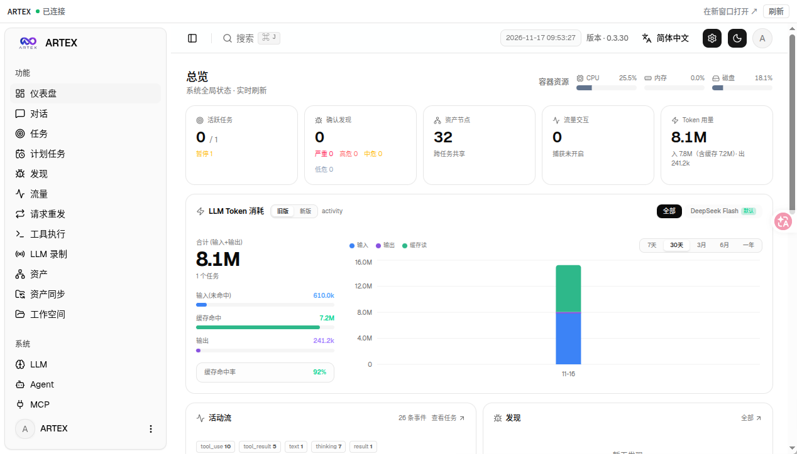

# dsh-artex

[](https://github.com/pandabalckpink/dsh-artex/actions/workflows/ci.yml)

Put an [ARTEX](https://github.com/RuoJi6/ARTEX) console in the
[DeepSeek Harness](https://github.com/deepseek-ai/deepseek-harness) Web GUI sidebar.



- **Sidebar entry + panel** — one click opens the ARTEX console inside DSH. The panel is an
  iframe on the ARTEX origin, so ARTEX's own login, cookies and routes keep working.
- **Host half** — probes the ARTEX server, optionally starts and supervises it
  (`managed: true`), and publishes the address the panel embeds at `GET /artex/info`.
- **MCP wiring is separate** — pair it with `@deepseek-ai/dsh-mcp-client` pointed at
  `<baseUrl>/mcp` and the agent gets ARTEX's tools as `mcp__artex__*`.

## Install

```bash
git clone https://github.com/pandabalckpink/dsh-artex.git
cd dsh-artex
ARTEX_MCP_TOKEN=artex_mcp_... ./install.sh ~/.dsh/profiles/web
```

`install.sh` copies the package into the profile's `node_modules` and appends the Loader
entries to `cordis.patch.yml`:

```yaml
- insert:
    - id: artex
      name: dsh-artex
      config:
        baseUrl: http://127.0.0.1:8787
        managed: false
    - id: mcp-artex
      name: '@deepseek-ai/dsh-mcp-client'
      config:
        serverName: artex
        transport: streamable-http
        url: http://127.0.0.1:8787/mcp
        headers:
          Authorization: 'Bearer artex_mcp_...'
```

Options: `--managed` lets DSH start and stop ARTEX itself, `--no-mcp` installs only the
panel, `--base-url` and `--token` override the defaults. Restart DSH (or let HMR recompose)
and the entry appears in the sidebar.

Manual install is the same two steps: copy the package into `<profile>/node_modules/dsh-artex`
and add the entries above.

## Config

| Field | Default | Meaning |
|---|---|---|
| `baseUrl` | `http://127.0.0.1:8787` | ARTEX server the panel embeds |
| `managed` | `false` | start/supervise ARTEX from this plugin |
| `binaryPath` | `/opt/artex/artex` | executable used when `managed` is true |
| `args` | `['-addr', ':8787']` | arguments for the managed executable |
| `cwd` | `/opt/artex` | working directory for the managed executable |
| `logFile` | `''` | append child stdout/stderr here; empty discards |
| `healthPath` | `/api/health` | readiness probe |
| `startupTimeoutMs` | `30000` | how long a managed start may take |

No schema is exported, so these values are merged over the defaults at apply time — a
profile entry may override any of them.

## How it works

```
sidebar.panellist "ARTEX"  ──►  main panel (iframe)  ──►  http://<artex>/login
GET /artex/info (host route) ──► { url, ok, managed, mcpUrl }
```

- The browser half registers `sidebar.panellist` and the `main` keyed slot through
  `ctx.slots.inject`, so both follow late slot declaration and teardown.
- The panel reads its target from `/artex/info` when it mounts; the host half serves that
  route through `ctx.webServer.register`.
- Embedding is cross-origin but *same-site* while both run on `127.0.0.1`, so ARTEX's
  `SameSite=Lax` session cookie keeps working. Serving DSH and ARTEX from **different sites**
  would drop that cookie and loop on `/login`.

## Notes

- ARTEX sets no `X-Frame-Options`, so the iframe is allowed. Do not point this at a server
  that forbids framing.
- The MCP bearer token is a long-lived credential that can create tasks; keep the profile
  file private and never commit it.
- Requires a DSH build with the client module system (`dsh.client` in `package.json`).

## Development

```bash
node scripts/check.mjs   # manifest contract, bundle registration, parsing, secret scan
bash -n install.sh       # shell syntax
```

CI runs both on every push and pull request.

## License

MIT
